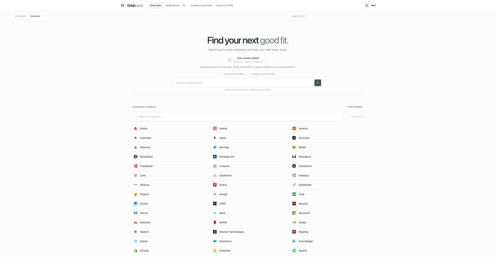
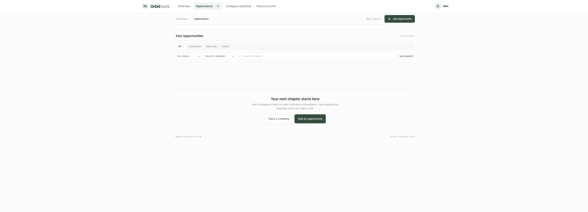
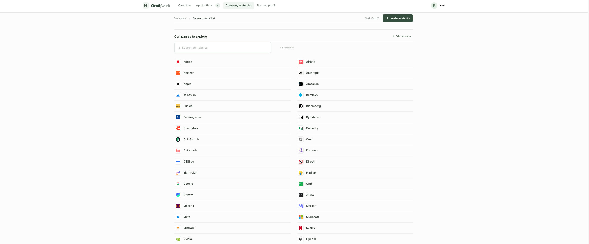

# JobSearch Assistant

A private, local-first workspace to organize your job search, track opportunities, and decide what to do next.

## Features

- **Opportunity tracker** — Manage roles, statuses, job details, notes, and application history.
- **Company watchlist** — Search saved companies or add one by name; keep career pages and roles of interest together.
- **Follow-up reminders** — Surface upcoming check-ins and applications that have gone quiet.
- **Resume matching** — Compare role requirements with your saved skills and experience; review matched evidence and gaps.
- **Local AI copilot** — Ask questions about your tracker, extract job details, and get resume evidence suggestions with Ollama.
- **MCP integration** — Let compatible AI clients search applications, review history, find follow-ups, and compare resume matches using read-only tools.
- **Backups** — Export or restore the full tracker as Excel, or import and export applications as CSV.

## Screenshots



| Applications | Company watchlist |
|---|---|
|  |  |

## Run locally

Requires Python 3.11 or newer.

```bash
python3 -m venv .venv
source .venv/bin/activate
pip install -r requirements.txt
python app.py
```

Open <http://127.0.0.1:8765>. To enable AI features, install [Ollama](https://ollama.com), start it, and download a model, for example `ollama pull qwen3:4b`.

## Local data and privacy

The app listens on `127.0.0.1`. Tracker data is stored in `data/job_tracker.xlsx`, which is excluded from Git. AI requests go to the Ollama service on your computer. If you choose **Read job page**, the app requests the URL you provide; the captured listing is saved locally.

## MCP server

Run `python mcp_server.py` from the project directory to expose read-only tracker tools over stdio. The tools search applications, retrieve role details and activity, find follow-ups, list companies, and compare resume matches. Tracker changes are made in the app.
